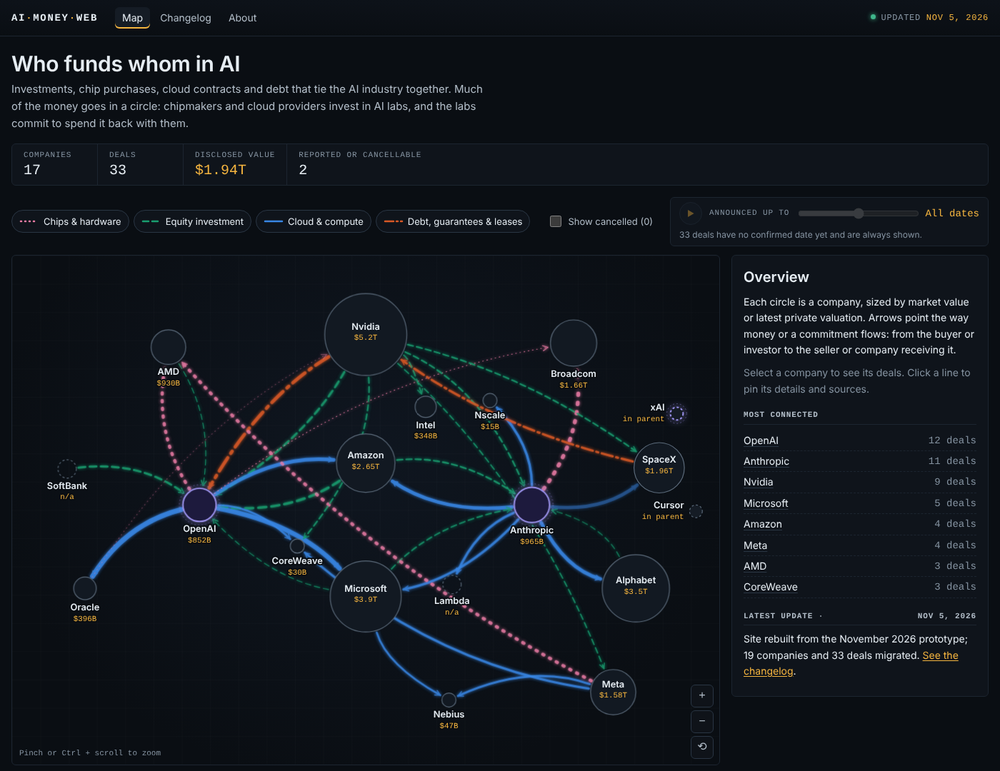

# AI Money Web

**Who funds whom in AI.** An interactive map of the investments, chip
purchases, cloud and compute contracts, and debt financing that link Nvidia,
OpenAI, Anthropic, Microsoft, Amazon, Oracle, the neoclouds and others.
It is researched every week and reviewed by a person before publishing.

**Live site:** https://tessa-wang.github.io/ai-debt/



## What it does

- **Interactive diagram.** Circles are sized by market value or latest
  valuation, and the AI labs are drawn as hubs. Arrows follow the money:
  colour and dash pattern show the category, width shows the amount, and
  faded lines are reported-only or cancellable deals.
- **Company panel.** Click a company, or press Tab and Enter, to see every
  deal in and out, with amounts, status and sources.
- **Tooltips.** Hover a line for its summary; click it to pin the tooltip
  and open its sources.
- **Timeline.** Scrub month by month, or press play, to watch the web grow.
- **Filters** by deal category, a **table view** of every deal, and
  **shareable links** (`#company=openai`, `#deal=<id>`).
- **Changelog** of every weekly update, and an **About** page covering the
  method and its limitations.

Everything is rendered from the JSON files in [`data/`](data). Adding a
company or a deal never needs a code change.

## How it's built

Plain HTML, CSS and vanilla JavaScript (ES modules), plus
[D3 v7.9.0](https://d3js.org/) from a pinned CDN URL with a subresource
integrity hash. There is no framework, build step or npm, so GitHub Pages
serves the repository as it is.

```
index.html            the map
changelog.html        weekly changes
about.html            method, data in plain English, limitations, credits
assets/
  style.css           "dark finance terminal" theme
  js/
    common.js         data loading, formatting, category/status vocab
    layout.js         force layout, label placement, edge curves
    graph.js          SVG drawing, highlighting, zoom
    panel.js          company side panel
    tooltip.js        hover / pinned deal tooltip
    timeline.js       month slider and play button
    table.js          table view of deals
    main.js           page state and wiring for index.html
    changelog.js      renders changelog.html
    about.js          live counts and definitions for about.html
data/
  companies.json      companies (nodes)
  deals.json          deals (arrows)
  changelog.json      one entry per weekly update
  meta.json           last-updated date, schema version
  layout.json         pinned positions for the biggest companies
scripts/
  validate.py         schema and sanity checks (runs in CI)
  diff_deals.py       drafts a changelog entry from two data versions
  schema.py           shared constants for both scripts
docs/
  DATA_SCHEMA.md      field-by-field schema and conventions
  WEEKLY_UPDATE.md    the scheduled-task prompt and the review checklist
.github/workflows/
  validate.yml        runs validate.py on every push and pull request
```

Some design decisions:

- **A stable layout.** The force simulation runs to completion before
  anything is drawn, with the biggest companies pinned by
  `data/layout.json`. d3-force's random source has a fixed seed, so the same
  data always gives the same picture and the map doesn't move about between
  visits. Phones get their own portrait layout.
- **No overlapping labels.** Labels are placed greedily: each tries
  inside, below, right, left, above and the diagonals, and takes the first
  spot that hits no circle and no earlier label.
- **Accessibility.** Every category has a dash pattern as well as a colour,
  and the colours were checked for colour-blind separation. Companies are
  keyboard-focusable buttons, and Escape closes things. The table is an
  alternative to the diagram for screen readers.
  `prefers-reduced-motion` turns off transitions and slows playback, and
  high-contrast mode is supported.
- **Shared code for the data scripts.** `validate.py` and `diff_deals.py`
  get their rules from `schema.py`, so the scripts and
  [DATA_SCHEMA.md](docs/DATA_SCHEMA.md) can't drift apart.

## Running it locally

Browsers block `fetch()` on `file://` pages, so serve the folder:

```bash
python3 -m http.server 8000
```

Then open http://localhost:8000/.

## Data workflow

Each week a Claude scheduled task researches news and SEC filings and drafts
updated data files. A person reviews them and commits. The full prompt and
the review steps are in [docs/WEEKLY_UPDATE.md](docs/WEEKLY_UPDATE.md).

Validate the data (Python 3 standard library only):

```bash
python3 scripts/validate.py
```

It exits non-zero on errors. Add `--strict` to also fail on warnings, and
`--no-todo` to fail on remaining TODO placeholders. Add
`--previous-ref origin/main` to also flag status regressions and removed
deals.

Draft a changelog entry from your uncommitted changes:

```bash
python3 scripts/diff_deals.py
```

Add `--apply` to insert the draft into `data/changelog.json`.

## Credits

Built by [YOUR NAME] and [TESSA'S NAME]. Research assisted by Claude.
Deal summaries are written in our own words; reporting belongs to the
outlets cited in each deal's sources. Not investment advice.
